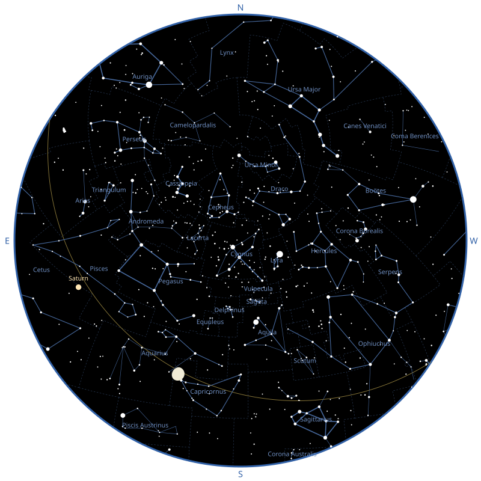
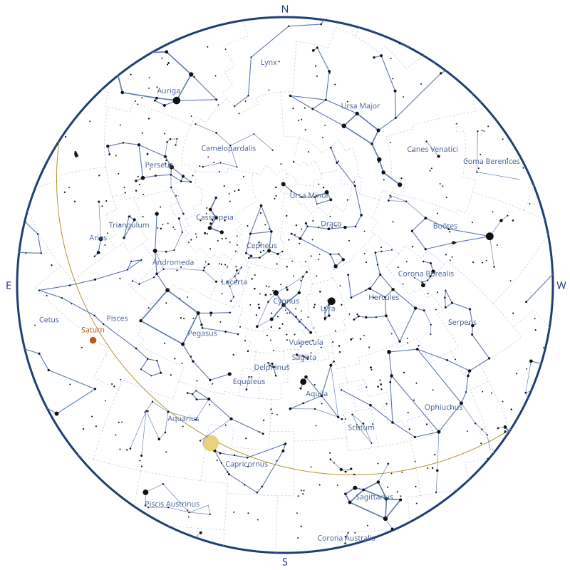
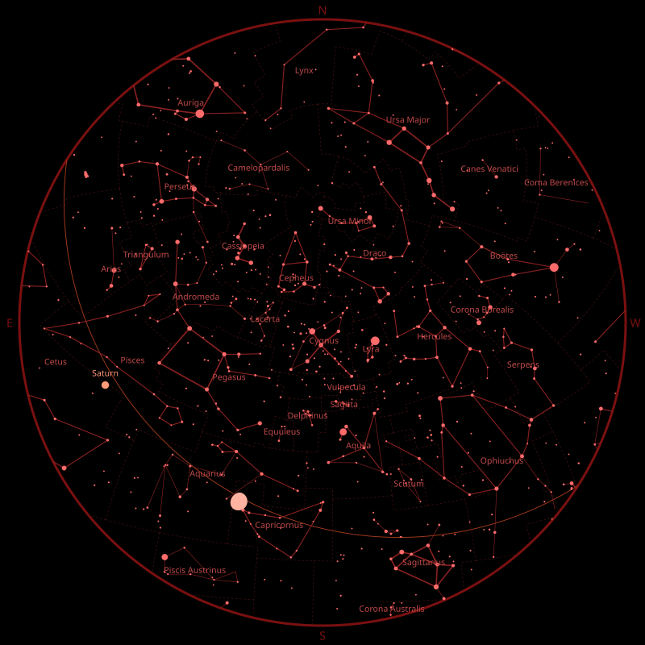

# Skymap

[](https://github.com/rhannequin/skymap/actions/workflows/ci.yml)
[](https://rubygems.org/gems/skymap)

Skymap is a Ruby library for generating maps of the sky.

<p align="center">
  
</p>

> [!WARNING]
> This project is in its very early stages, please expect breaking changes.

## Installation

Install the gem and add it to the application's Gemfile by executing:

```bash
bundle add skymap
```

If Bundler is not being used to manage dependencies, install the gem by
executing:

```bash
gem install skymap
```

## Usage

Skymap draws the sky seen by an observer at a given instant, and returns it
as an SVG string. This is the map above:

```ruby
require "skymap"

Astronoby::Ephem.download(name: "inpop19a.bsp", target: "inpop19a.bsp")
ephem = Astronoby::Ephem.load("inpop19a.bsp")

observer = Astronoby::Observer.new(
  latitude: Astronoby::Angle.from_degrees(48.8575),
  longitude: Astronoby::Angle.from_degrees(2.3514)
)
instant = Astronoby::Instant.from_time(Time.utc(2026, 9, 23, 20))
canvas = Skymap::Canvas.new(size: 800, padding: 24)
stars = Skymap::Catalog::Stars.new.to_a
lines = Skymap::Catalog::ConstellationLines.new.to_a

chart = Skymap::Chart.new(observer: observer, instant: instant, canvas: canvas)
svg = chart.render(
  Skymap::Layers::ConstellationBoundaries.new(
    boundaries: Skymap::Catalog::ConstellationBoundaries.new
  ),
  Skymap::Layers::Ecliptic.new,
  Skymap::Layers::ConstellationLines.new(lines: lines, stars: stars),
  Skymap::Layers::Stars.new(stars: stars),
  Skymap::Layers::ConstellationNames.new(lines: lines, stars: stars),
  Skymap::Layers::Planets.new(ephem: ephem, labels: true),
  Skymap::Layers::Moon.new(ephem: ephem),
  Skymap::Layers::CardinalDirections.new
)

File.write("sky_map.svg", svg)
```

The observer and the instant are [Astronoby] objects. Astronoby computes where
each star is in the sky and Skymap draws it. The Moon and the planets need an
ephemeris, which the first lines download and load (see [Moon](#moon)). Every
layer is optional: leave one out to hide what it draws.

The map at the top of this page is generated by `bin/build_readme_map`, which
runs this code with the ephemeris of the tests.

The map is a disk: the zenith is at the center and the horizon is the edge. It
uses a [stereographic projection], the most common one for sky charts because
it keeps the shapes of constellations, even near the horizon. North is at the
top and East is on the left, as on a map you would hold above your head.

### Canvas

The canvas is the square SVG the map is drawn on. `size` is its width and
height, and `padding` is the space between the horizon and the edge of the
SVG.

#### Print size

The SVG is written in pixels by default. To print it at a known size, give the
canvas a `print_size:`: the length of the side of the square, in millimeters
(`:mm`), centimeters (`:cm`) or inches (`:in`):

```ruby
canvas = Skymap::Canvas.new(
  size: 800,
  padding: 24,
  print_size: Skymap::PrintSize.new(length: 190, unit: :mm)
)
```

The SVG gets `width="190mm"` and `height="190mm"`, and its `viewBox` stays in the
units of the canvas, so the map is the same and a browser or a print dialog
prints it at 190 mm.

`Skymap::PrintSize.paper` gives the largest square that fits in the width of a
sheet of paper, minus a margin of 10 mm on each side by default (`margin:`, in
millimeters). The papers are `:a5`, `:a4`, `:a3`, `:letter` and `:tabloid`:

```ruby
Skymap::PrintSize.paper(:a4)                # 190 mm
Skymap::PrintSize.paper(:letter, margin: 5) # 205.9 mm
```

Add a [scale](#scale) to the map to read angles on the printed chart.

### View

By default, the map is the whole sky. Pass a `view:` to zoom on an area of it:
the center of the area, as the equatorial coordinates of a point of the sky, at
J2000 or at the date of the chart (or horizontal coordinates), and the field of
view, the angle between the opposite sides of the map:

```ruby
view = Skymap::View.new(
  center: Astronoby::Coordinates::Equatorial.new(
    right_ascension: Astronoby::Angle.from_hours(5.6),
    declination: Astronoby::Angle.zero,
    epoch: Astronoby::JulianDate::J2000
  ),
  field_of_view: Astronoby::Angle.from_degrees(50)
)

chart = Skymap::Chart.new(
  observer: observer,
  instant: instant,
  canvas: canvas,
  view: view
)
```

Equatorial coordinates at any other epoch raise an `ArgumentError`. The field
of view is an `Astronoby::Angle` of more than 0 and up to 180 degrees. The sky
is still seen from the observer. By default, the zenith is at the top of the
map, except when the zenith is in the view: the north is at the top then, as in
the whole sky. The next section changes that. With
horizontal coordinates, only the altitude and the azimuth are used, as seen by
the observer of the chart. The layers draw what is in the view only. The
horizon is drawn as a line when it is in the view, and the edge of the map is a
thin outline. It is no longer the horizon, so the cardinal directions are not
drawn. The Sun and the Moon are drawn at their size in the sky once it is
larger than their usual size on the map. The stars are limited by the catalog:
a field of view of 10 degrees or more shows enough of them.

#### Orientation

A map in a telescope is turned in a way that depends on the telescope and on
its mount. Three options of `View` give the same orientation on the map:

- `orientation: :zenith_up` (the default) keeps the zenith at the top, like an
  alt-az mount does at the meridian.
- `orientation: :equatorial` puts the north celestial pole at the top and the
  east on the left, like the sky seen through an equatorial mount.
- `rotation:` turns the map clockwise, by an `Astronoby::Angle`.
- `mirrored: true` swaps the left and the right, before the rotation.

On an equatorial mount, a refractor or a catadioptric telescope with a
diagonal shows a mirrored image, and a Newtonian shows the sky turned by half a
turn:

```ruby
field_of_view = Astronoby::Angle.from_degrees(4)

Skymap::View.new(
  center: center,
  field_of_view: field_of_view,
  orientation: :equatorial
)
Skymap::View.new(
  center: center,
  field_of_view: field_of_view,
  orientation: :equatorial,
  mirrored: true
)
Skymap::View.new(
  center: center,
  field_of_view: field_of_view,
  orientation: :equatorial,
  rotation: Astronoby::Angle.from_degrees(180)
)
```

The north is the one of the celestial pole of the date, in both hemispheres.
The lit side of the Moon follows the orientation too.

### Accuracy

Stars are drawn where they are at the date of the chart, not at their catalog
position: their proper motion is applied from J2000 to the instant of the chart,
then the position is precessed and nutated to the true equator and equinox of
date, and seen from the observer. `Skymap::Star#coordinates_at(instant)` gives
the first step, as `Astronoby::Coordinates::Equatorial` at J2000. A star without
a proper motion stays where it is, at any epoch; with a proper motion, its
coordinates must be at J2000, or `Skymap::Star` raises an `ArgumentError`. For a
star that has a proper motion but no parallax or no radial velocity, which is
the case of most of the catalog for the parallax, a parallax of 1 milliarcsecond
and a radial velocity of 0 are assumed: the position changes by less than 0.1
arcsecond. To keep the charts fast, the proper motion is left out of a star that
it moves by less than 0.005 pixel on the chart, so a star is drawn within 0.005
pixel of where the full propagation puts it.

These are not applied:

- the annual aberration of light, up to about 20 arcseconds
- the annual parallax, under 1 arcsecond
- the atmospheric refraction, which lifts a star near the horizon by up to half
  a degree
- the rounding of the positions of the Bright Star Catalogue, about 1 arcsecond

The proper motion is visible in charts with a field of view under a degree:
Arcturus moves by 1 arcminute in 27 years. In a larger field, it is smaller
than a pixel for most stars.

### Themes

A theme gives the colors of the map. `Chart` draws the dark theme by default,
light stars on a black sky. Pass `theme:` to draw another one:

```ruby
chart = Skymap::Chart.new(
  observer: observer,
  instant: instant,
  canvas: canvas,
  theme: Skymap::Theme.light
)
```

- `Skymap::Theme.dark`: the default.
- `Skymap::Theme.light`: dark stars on a white sky, for printing.
- `Skymap::Theme.night`: shades of red on a black sky, which keep your eyes
  adapted to the dark when you use the map outside.

<p align="center">
  
  
  
</p>

Build your own from a built-in one, changing the colors you want. Each color
is a string SVG accepts, such as `"#ffeedd"` or `"gold"`:

```ruby
theme = Skymap::Theme.dark.with(
  sky: "#0b1026",
  star: "#fff4d6"
)
```

Use `"none"` as a color to leave something out. The dark theme has
`background: "none"`, so the SVG is transparent around the sky, and with
`sky: "none"` the sky is transparent too, to put the map on a background of
your own. With `horizon: "none"`, the edge of the sky is not outlined.

The [theme reference][themes-reference] lists every color and shows how to
build a theme from scratch.

### Layers

A map is the sky, with the layers given to `Chart#render` drawn on top of it,
in order: each layer is drawn over the previous ones. Without layers,
`Chart#render` draws an empty sky. Leave a layer out to hide what it draws.

#### Stars

`Skymap::Layers::Stars` draws stars, bigger the brighter they are.
`Skymap::Catalog::Stars` gives the 9,096 stars of the Yale Bright Star
Catalogue (see [Data sources](#data-sources)), but the layer accepts any list
of `Skymap::Star`.

Stars are drawn at their position at the date of the chart, with their proper
motion applied (see [Accuracy](#accuracy)).

By default, only stars of magnitude 5 or brighter are drawn, which is about
what you can see from a suburban sky. Use `magnitude_limit:` to draw more or
fewer stars:

```ruby
Skymap::Layers::Stars.new(stars: stars, magnitude_limit: 6)
```

#### Star names

`Skymap::Layers::StarNames` writes the names of the brightest stars, next to
them, on the side of the center of the map. A name next to the horizon is moved
towards the center until it fits in the sky, as far as the width of the text
can be estimated. It takes the same stars as the stars layer, and
`Skymap::Catalog::StarNames` gives the names of 333 stars of the catalog, as
approved by the IAU (see [Data sources](#data-sources)):

```ruby
Skymap::Layers::StarNames.new(stars: stars)
```

Only the stars of magnitude 2 or brighter are named by default, which is about
fifty stars. Use `magnitude_limit:` to name more or fewer stars:

```ruby
Skymap::Layers::StarNames.new(stars: stars, magnitude_limit: 3)
```

Names sit just outside the dots of the stars. Dots get smaller as the stars
layer draws fainter stars, so if you give it a `magnitude_limit:` other than 5,
give the same one to `stars_magnitude_limit:`:

```ruby
Skymap::Layers::Stars.new(stars: stars, magnitude_limit: 6)
Skymap::Layers::StarNames.new(stars: stars, stars_magnitude_limit: 6)
```

Use `names:` to write the names differently: it takes anything that gives a
name from the Harvard Revised number of a star (`hr`), such as a hash. A star
without a name is left out:

```ruby
Skymap::Layers::StarNames.new(
  stars: stars,
  names: {2491 => "Sirius", 424 => "Étoile polaire"}
)
```

#### Constellation boundaries

`Skymap::Layers::ConstellationBoundaries` draws the boundaries between the
constellations as thin dashed lines, and stops the ones that cross the horizon
at the edge of the sky. `Skymap::Catalog::ConstellationBoundaries` gives the
borders of the 88 IAU constellations (see [Data sources](#data-sources)).

Layers are drawn in the order they are given: put the boundaries first to draw
them below the lines and the stars.

#### Constellation lines

`Skymap::Layers::ConstellationLines` draws the lines of the constellations.
`Skymap::Catalog::ConstellationLines` gives the lines of the 88 IAU
constellations (see [Data sources](#data-sources)).

Figures are drawn whole, even when some of their stars are fainter than the
magnitude limit of the stars layer, and lines that cross the horizon stop at
the edge of the sky. The stars given to the layer must include the stars of
the lines: lines to a star that is not given are left out.

Each line has a weight, as drawn on the IAU charts: `bold` for the best-known
shapes (the asterisms, such as the Big Dipper or the Teapot of Sagittarius),
`normal` for the rest of the figures and `thin` for the secondary lines. The
layer draws the lines it's given, so select the ones you want, for example
only the asterisms:

```ruby
asterisms = Skymap::Catalog::ConstellationLines.new.select do |line|
  line.weight == :bold
end

Skymap::Layers::ConstellationLines.new(lines: asterisms, stars: stars)
```

#### Constellation names

`Skymap::Layers::ConstellationNames` writes the name of each constellation in
the middle of its stars. It takes the same lines and stars as the
constellation lines layer, since the lines tell which stars belong to which
constellation:

```ruby
lines = Skymap::Catalog::ConstellationLines.new.to_a

Skymap::Layers::ConstellationNames.new(lines: lines, stars: stars)
```

Reading the lines into an array with `to_a`, once, saves the layers from
reading the file again each.

A constellation is named when more than half of its stars are above the
horizon. When its figure is in several parts, such as Serpens, the name goes in
the middle of the biggest part that is above the horizon. Mensa and
Microscopium have no lines, so they have no name on the map.

The names are in English, from `Skymap::Catalog::ConstellationNames`. Use
`names:` to write them differently: it takes anything that gives a name from
the IAU abbreviation of a constellation, such as a hash. A constellation
without a name is left out:

```ruby
Skymap::Layers::ConstellationNames.new(
  lines: lines,
  stars: stars,
  names: {"UMa" => "Grande Ourse", "UMi" => "Petite Ourse"}
)
```

#### Moon

`Skymap::Layers::Moon` draws the Moon where it is in the sky, with its phase.
The lit side of the Moon faces the Sun on the map: the Moon is turned with the
projection, wherever it is on the map and whatever the orientation of the view.

Astronoby needs an ephemeris to compute where the Moon is: download one once,
load it and give it to the layer (see the
[Astronoby documentation][astronoby-ephem] to pick one):

```ruby
Astronoby::Ephem.download(name: "inpop19a.bsp", target: "inpop19a.bsp")
ephem = Astronoby::Ephem.load("inpop19a.bsp")

Skymap::Layers::Moon.new(ephem: ephem)
```

The Moon is drawn larger than it is, as on most sky maps: at its true size it
would be a dot as small as the faintest stars. Its radius is 3% of the radius
of the sky. When the center of the Moon is below the horizon, it is left out.

#### Sun

`Skymap::Layers::Sun` draws the Sun where it is in the sky. Like the Moon, it
needs an ephemeris (see [Moon](#moon)):

```ruby
Skymap::Layers::Sun.new(ephem: ephem)
```

The Sun is drawn larger than it is, at the same size as the Moon: 3% of the
radius of the sky. When the center of the Sun is below the horizon, it is left
out.

#### Planets

`Skymap::Layers::Planets` draws the planets, from Mercury to Neptune, where
they are in the sky. They need an ephemeris too (see [Moon](#moon)). A planet
is drawn as a star would be, bigger the brighter it is, with a warm tint so it
stands out from the stars:

```ruby
Skymap::Layers::Planets.new(ephem: ephem)
```

As for the stars, only planets of magnitude 5 or brighter are drawn by
default, which leaves out Uranus and Neptune. Use `magnitude_limit:` to draw
more or fewer planets. The magnitude of a planet changes over time, so a
planet can come in and out of the map:

```ruby
Skymap::Layers::Planets.new(ephem: ephem, magnitude_limit: 6)
```

Planets below the horizon are left out.

Use `labels: true` to write the name of each planet next to it, on the side of
the center of the map so it stays inside the sky:

```ruby
Skymap::Layers::Planets.new(ephem: ephem, labels: true)
```

The names are in English. Use `names:` to write them differently, with a hash
of the planets (`:mercury`, `:venus`, `:mars`, `:jupiter`, `:saturn`,
`:uranus` and `:neptune`). A planet without a name is drawn without it:

```ruby
Skymap::Layers::Planets.new(
  ephem: ephem,
  labels: true,
  names: {saturn: "Saturne", jupiter: "Jupiter"}
)
```

#### Ecliptic

`Skymap::Layers::Ecliptic` draws the ecliptic, the line the Sun follows in the
sky over a year. The Moon and the planets are always close to it. It needs no
data, and it stops at the horizon:

```ruby
Skymap::Layers::Ecliptic.new
```

#### Grid

`Skymap::Layers::Grid` draws the celestial coordinate grid: the lines of right
ascension and the circles of declination, including the celestial equator. They
are the coordinates of the stars in a catalog, and the grid shows where the
sky turns around the celestial pole. It needs no data, and it stops at the
horizon:

```ruby
Skymap::Layers::Grid.new
```

The lines are 30 degrees apart (2 hours of right ascension) by default. Use
`step:`, an `Astronoby::Angle`, to draw them closer or further apart. It is
between 1 and 90 degrees and divides 360 degrees. For a line of right ascension
every hour:

```ruby
Skymap::Layers::Grid.new(step: Astronoby::Angle.from_hours(1))
```

By default the grid is in the equator and equinox of J2000, like the
coordinates of atlases and catalogs. Use `epoch: :of_date` to draw it in the
true equator and equinox of the date of the chart instead. The declination
circles are then centered on the true celestial pole of that date, which is
what a polar-aligned equatorial mount shows:

```ruby
Skymap::Layers::Grid.new(epoch: :of_date)
```

The two grids differ by a fraction of a degree today, which only shows when the
map is zoomed on a small area of the sky. For a view that follows a
polar-aligned equatorial mount, use `:of_date`, which pairs with
`orientation: :equatorial` (north celestial pole at the top). Keep `:j2000` to
read coordinates off the grid and look them up in an atlas or a catalog.

Give the grid first to `Chart#render` to draw the stars and the other layers
over it.

#### Field circles

`Skymap::Layers::FieldCircles` draws circles that show what a finder scope or an
eyepiece covers in the sky. Give it the fields to draw, as `Skymap::Field` or
`Skymap::Setup` objects (see [Telescope, eyepiece and fields](#telescope-eyepiece-and-fields)):

```ruby
Skymap::Layers::FieldCircles.new(fields: [finder, setup], labels: true)
```

The circles are centered on the center of the [view](#view), so the layer needs
a view, and nothing is drawn without one. Use `center:` to draw them around
another point, as the equatorial or horizontal coordinates of a point of the
sky, such as a target when the view is wider than the circles:

```ruby
Skymap::Layers::FieldCircles.new(fields: [setup], center: target)
```

A circle has the size of its field on the sphere, then it is projected, so it
keeps its size and its shape anywhere in the map. Each circle and its label are drawn in
the `field_circle` color of the [theme](#themes). In a view, a circle is
drawn whole, even below the horizon, and a circle that does not reach the view
is left out. In the whole sky, which has no center unless you give a `center:`,
a circle stops at the horizon.

With `labels: true`, the label of each field is written next to its circle.
A label that would fall outside the view is left out. Give the layer last to
`Chart#render` to draw the circles over the stars.

#### Cardinal directions

`Skymap::Layers::CardinalDirections` labels the cardinal directions (N, E, S,
W) in the padding, with a size that follows it: a padding of about 3% of the
size gives readable labels. It draws nothing when the map has a [view](#view).

#### Scale

`Skymap::Layers::Scale` draws a scale bar with its length as a label, such as
`1°`, `30′` or `10″`, in the lower left of a map with a [view](#view). It draws
nothing on the whole sky, where the scale changes from one place to another:

```ruby
Skymap::Layers::Scale.new
```

The bar is the longest of 1, 2, 5, 10, 20 and 30 arc-seconds, arc-minutes or
degrees that is at most a fifth of the width of the map. It stays horizontal
and the same in every [orientation](#orientation) of the view. The scale of the map
changes from the center to the edge, and the bar follows it: its length is the
angle it says at the place where it is drawn. A straight bar on the map is a
small circle on the sky, not the shortest path between its ends, so the angle
between the ends is a little smaller than the label on wide fields. The
difference is below 0.01% up to a field of view of 90 degrees, which covers
finder charts, and at most 0.1% at 120 degrees and 0.3% at 180 degrees. Nothing
is drawn when even 1 arc-second is too long, for a field of view below about
0.0014 degrees (5 arc-seconds). The bar and its label use the `scale`
color of the theme. With a [print size](#print-size), the bar is as long on
paper as the angle it says.

### Telescope, eyepiece and fields

An eyepiece in a telescope shows a small part of the sky, often less than a
degree wide. These classes describe the equipment, compute that part of the
sky, and give it to a [view](#view) or to the [field circles](#field-circles).

`Skymap::Telescope` has a focal length and an aperture, in millimeters, as
`focal_length_mm` and `aperture_mm`. `Skymap::Eyepiece` has a focal length in
millimeters, as `focal_length_mm`, and the apparent field of view that its
maker gives, as an `Astronoby::Angle`. All the numbers must be above 0, and
the apparent field of view up to 180 degrees:

```ruby
telescope = Skymap::Telescope.new(focal_length_mm: 1200, aperture_mm: 200)
eyepiece = Skymap::Eyepiece.new(
  focal_length_mm: 25,
  apparent_field_of_view: Astronoby::Angle.from_degrees(52)
)
```

`Skymap::Setup` pairs a telescope with an eyepiece, and computes what you see
with them:

```ruby
setup = Skymap::Setup.new(telescope: telescope, eyepiece: eyepiece)

setup.magnification # => 48.0
setup.true_field    # => an Astronoby::Angle of 1.083 degrees
setup.label         # => "25 mm, 48×, 1.1°"
```

- `magnification` is the focal length of the telescope divided by the one of
  the eyepiece, as a `Float`.
- `true_field` is the part of the sky you see, as an `Astronoby::Angle`: the
  apparent field of view divided by the magnification, the usual first-order
  formula. With a Barlow lens or a focal reducer, give the effective focal
  length of the telescope. It is what `field_of_view:` of a view takes, to draw
  a map as wide as the eyepiece.
- `label` is a short text for the circle: the focal length of the eyepiece,
  the magnification and the true field, in degrees (with at most one decimal)
  from 1 degree, in arcminutes (`15′`) below, and in arcseconds (`30″`) below
  one arcminute.

`Skymap::Field` is a field that does not come from a setup, such as a finder
scope, a Telrad ring or the frame of a camera: its `true_field` as an
`Astronoby::Angle`, and the `label` you choose:

```ruby
finder = Skymap::Field.new(
  true_field: Astronoby::Angle.from_degrees(5),
  label: "Finder 5°"
)
```

`FieldCircles` takes anything with a `true_field` and a `label`, so a list of
fields and setups draws them together around a target, on a map twice as wide
as the eyepiece:

```ruby
view = Skymap::View.new(
  center: target,
  field_of_view: Astronoby::Angle.from_degrees(
    setup.true_field.degrees * 2
  )
)

chart = Skymap::Chart.new(
  observer: observer,
  instant: instant,
  canvas: canvas,
  view: view
)
svg = chart.render(
  Skymap::Layers::Stars.new(stars: stars, magnitude_limit: 7),
  Skymap::Layers::FieldCircles.new(fields: [finder, setup], labels: true)
)
```

## Examples

The [examples](https://github.com/rhannequin/skymap/tree/main/examples)
folder has scripts and the maps they draw, for
different combinations of layers, themes and observers: the naked-eye sky, a
printable map of the constellations, the planets, a night vision map for
outdoors, the southern sky and more. Start from the one closest to what you
want to draw.

## Data sources

### Stars

`data/stars.csv` is extracted from the [Yale Bright Star Catalogue, 5th
Revised Edition][bsc5] (VizieR V/50): the 9,096 stars of the catalog with
their Harvard Revised number (`hr`), J2000 coordinates (`right_ascension` in
hours, `declination` in degrees) and visual magnitude (`magnitude`). The 14
non-stellar entries kept only for numbering are left out.

The catalog also gives the astrometry of each star, blank when unknown: the
proper motion in right ascension (`proper_motion_ra`, which includes the cosine
of the declination) and in declination (`proper_motion_dec`) in mas/yr for
every star, the `parallax` in mas for the 3,100 stars that have a positive one
(387 of them are dynamical parallaxes, not trigonometric ones), and the
`radial_velocity` in km/s for 9,090 stars.

`Skymap::Catalog::Stars` loads them as an `Astronoby::AngularVelocity`, an
`Astronoby::Angle` and an `Astronoby::Velocity` on `Skymap::Star`. They are all
optional, so a list of your own stars can leave them out: the proper motions are
given together, and the parallax and the radial velocity are `nil` when
unknown.

> Hoffleit, D., Warren Jr., W. H., 1991, _The Bright Star Catalogue, 5th
> Revised Ed. (Preliminary Version)_, Astronomical Data Center, NSSDC/ADC.

The file is generated with `bin/build_catalog`, which downloads the catalog
from CDS.

This research has made use of the VizieR catalogue access tool, CDS,
Strasbourg, France ([DOI: 10.26093/cds/vizier][vizier-doi]). The original
description of the VizieR service was published in 2000, A&AS 143, 23.

### Star names

`data/star_names.csv` gives the name of 333 stars of `data/stars.csv` from
their Harvard Revised number (`hr`), as listed in the [IAU Catalog of Star
Names][iau-csn] by the IAU Working Group on Star Names. The catalog also names
stars that are not in the Bright Star Catalogue, such as the host stars of
exoplanets, which are left out.

The file is generated with `bin/build_star_names`, which downloads the list
and keeps the stars with an HR number. The IAU asks to cite its official
version of the list at <https://www.iau.org/public/themes/naming_stars/>, and
releases its products under a Creative Commons Attribution license.

### Constellations

`data/constellations/iau/lines.csv` holds the lines of the 88 IAU
constellations (Mensa and Microscopium have none), one row per segment:

- `constellation`: the IAU abbreviation of the constellation.
- `from_hr`, `to_hr`: the ends of the segment, as HR numbers of stars of
  `data/stars.csv`. An end with two HR numbers, such as `5190 5193`, is the
  midpoint of these two stars: the IAU charts draw some lines to a pair of
  close stars rather than to one of them.
- `weight`: `bold` for the lines the charts draw thickest, the best-known
  shapes such as the Big Dipper or the Teapot of Sagittarius, `normal` for the
  rest of the main figures, `thin` for the secondary lines.

The lines are transcribed from the [IAU constellation maps][oae-maps] of the
IAU Office of Astronomy for Education, adapted from the original charts by
the IAU and Sky & Telescope magazine (Roger Sinnott & Rick Fienberg), with the
constellation patterns of Alan MacRobert, and released under the [Creative
Commons Attribution 4.0 International][cc-by-4] license.

The file was transcribed once from the vector PDF of each map, by matching the
ends of the lines drawn on the maps to the stars of the catalog, and checked
against the maps. It is not regenerated by a script.

### Constellation names

`data/constellations/iau/names.csv` gives the English name of each of the 88
IAU constellations from its IAU abbreviation, as listed by the International
Astronomical Union.

### Constellation boundaries

`data/constellations/iau/boundaries.csv` holds the borders between the 88 IAU
constellations, one row per point of a border, in order:

- `border`: the number of the border. Each border between two constellations
  is listed once.
- `constellations`: the IAU abbreviations of the two constellations the border
  separates.
- `right_ascension` (hours) and `declination` (degrees): the coordinates of
  the point, in J2000. The borders of the constellations are straight lines of
  right ascension and declination in B1875, and curves in J2000: there is a
  point about every degree to follow them.

The borders come from the [Catalogue of Constellation Boundary Data][vi49] by
Davenhall and Leggett (VizieR VI/49), in the version of Bill J. Gray that
lists the constellation on each side of a border. They are the boundaries
defined by Delporte in 1930, in B1875 coordinates.

> Davenhall, A. C., Leggett, S. K., 1989, _Catalogue of Constellation Boundary
> Data_, Royal Observatory Edinburgh.

The file is generated with `bin/build_boundaries`, which downloads the
catalog from CDS, keeps each shared border once, adds the points along the
borders and precesses them to J2000 with Astronoby.

### Deep-sky objects

`data/deep_sky_objects.csv` holds the 109 Messier objects, from
[OpenNGC][openngc] (release v20260501, commit `36cb178`), one row per object:

- `designation`: `M31` for a Messier object. Objects of the NGC and IC
  catalogs, once added, are named like `NGC 7000`, without zero padding.
- `name`: the first common name of OpenNGC, blank when it has none.
- `type`: one of the types below.
- `right_ascension` (hours) and `declination` (degrees): J2000 coordinates.
- `magnitude`: the visual (V) magnitude, or the blue (B) one when there is no
  V magnitude. Every Messier object has a V magnitude.
- `major_axis` and `minor_axis`: the size in arcminutes, blank when unknown.
- `position_angle`: the angle of the major axis in degrees, from the north
  through the east, blank when unknown. OpenNGC only gives it to galaxies, M24
  and the Pleiades.

The OpenNGC types become these ones:

| OpenNGC                                | `type`              |
| -------------------------------------- | ------------------- |
| `G`, `GPair`, `GTrpl`, `GGroup`        | `galaxy`            |
| `OCl`                                  | `open_cluster`      |
| `GCl`                                  | `globular_cluster`  |
| `PN`                                   | `planetary_nebula`  |
| `Neb`, `HII`, `EmN`, `RfN`, `Cl+N`     | `nebula`            |
| `SNR`                                  | `supernova_remnant` |
| `*Ass`                                 | `asterism`          |
| `**`                                   | `double_star`       |
| `Other`                                | `other`             |

M42 is the only Messier object of OpenNGC type `Cl+N`, a cluster with
nebulosity: it is a `nebula`, as its nebulosity is far larger than the
Trapezium cluster at its center. M24 (a star cloud) is an `asterism`, M73 is
`other`, and M40 is a `double_star`: OpenNGC lists it with no size. Any other
OpenNGC type stops the build.

`Skymap::Catalog::DeepSkyObjects` loads them as `Skymap::DeepSkyObject`, with
the sizes as `Astronoby::Angle`. A `minor_axis` is blank for most clusters and
some nebulae: `Skymap::DeepSkyObject#axes` gives the major and the minor axis
of an object, and takes a blank minor axis as a round object, with the same
diameter as the major axis. It gives `nil` when the size is unknown (M40, M73).

OpenNGC identifies M102 as a duplicate of M101 (its identity is controversial
and it follows the assumption of NED), so M102 is left out and the file has no
`M102`. M40 and M45 are not in the NGC and IC catalogs: they come from the
addendum of OpenNGC, where the Pleiades are listed as Melotte 22.

The file is generated with `bin/build_deep_sky_objects`, which downloads
`NGC.csv` and `addendum.csv` from the pinned commit of OpenNGC and keeps the
Messier objects. Pass the path of a local directory holding the two files to
build from it. The output must not change when you run it again.

OpenNGC is released under the [Creative Commons Attribution-ShareAlike 4.0
International][cc-by-sa-4] license, and so is `data/deep_sky_objects.csv`: the
license, with the credits and changes, is in
`data/LICENSE-deep_sky_objects.txt`, shipped with the gem. If you share this
file or data adapted from it, you must release your version under the same
license. The code of Skymap stays under the MIT license.

OpenNGC merges the data of the NASA/IPAC Extragalactic Database (NED),
HyperLEDA, SIMBAD, the HEASARC archive and Harold Corwin's NGC/IC Positions and
Notes. This research has made use of the NASA/IPAC Extragalactic Database
(NED), which is operated by the Jet Propulsion Laboratory, California Institute
of Technology, under contract with the National Aeronautics and Space
Administration, of the HyperLEDA database, and of the SIMBAD database, operated
at CDS, Strasbourg, France.

### Ephemeris of the tests

The tests of the Sun, the Moon and the planets use
`spec/fixtures/de440s_2025_2030_excerpt.bsp`, an excerpt of DE440s, the
planetary and lunar ephemeris of the [Jet Propulsion Laboratory][jpl-ephemerides],
distributed by [NAIF][naif]. It only keeps the barycenters of the planets, the
Sun, the Moon and the Earth, from 2025 to 2030. As NAIF asks for modified
kernels, its comment area names this project as the last to modify it, and
points to the original kernel. It is not part of the gem.

> Park, R. S., Folkner, W. M., Williams, J. G., Boggs, D. H., 2021, _The JPL
> Planetary and Lunar Ephemerides DE440 and DE441_, The Astronomical Journal,
> 161, 105.

## Development

After checking out the repo, run `bin/setup` to install dependencies. Then, run
`bundle exec rake` to run the tests and the linter. You can also run
`bin/console` for an interactive prompt that will allow you to experiment.

- Tests: `bundle exec rspec`
- Linter ([Standard Ruby] through RuboCop): `bundle exec rubocop`
  (`bundle exec rubocop -a` to autocorrect)
- Render times of representative charts: `bin/benchmark` (`RUNS=10` to change
  the number of runs it keeps the best of)
- Everything CI checks: `bin/ci`

### Releasing

1. Update the version number in `lib/skymap/version.rb` and `CHANGELOG.md`.
2. Commit, then tag and push: `git tag vX.Y.Z && git push origin vX.Y.Z`.
3. The [Release workflow](.github/workflows/release.yml) builds and publishes
   the gem to RubyGems.org using [trusted publishing].

## Contributing

Bug reports and pull requests are welcome on GitHub at
https://github.com/rhannequin/skymap. This project is intended to be a safe,
welcoming space for collaboration, and contributors are expected to adhere to
the [code of conduct](CODE_OF_CONDUCT.md).

## License

The gem is available as open source under the terms of the [MIT License]. The
data file `data/deep_sky_objects.csv` is adapted from OpenNGC and released under
[CC BY-SA 4.0][cc-by-sa-4] (see [Data sources](#deep-sky-objects)).

## Code of Conduct

Everyone interacting in the Skymap project's codebases, issue trackers, chat
rooms and mailing lists is expected to follow the
[code of conduct](CODE_OF_CONDUCT.md).

[Astronoby]: https://github.com/rhannequin/astronoby
[stereographic projection]: https://en.wikipedia.org/wiki/Stereographic_map_projection
[Standard Ruby]: https://github.com/standardrb/standard
[trusted publishing]: https://guides.rubygems.org/trusted-publishing/
[MIT License]: https://opensource.org/licenses/MIT
[bsc5]: https://cdsarc.cds.unistra.fr/viz-bin/cat/V/50
[vizier-doi]: https://doi.org/10.26093/cds/vizier
[themes-reference]: https://github.com/rhannequin/skymap/blob/main/docs/themes.md
[astronoby-ephem]: https://github.com/rhannequin/astronoby/blob/main/docs/ephem.md
[oae-maps]: https://www.astro4edu.org/
[vi49]: https://cdsarc.cds.unistra.fr/viz-bin/cat/VI/49
[jpl-ephemerides]: https://ssd.jpl.nasa.gov/planets/eph_export.html
[naif]: https://naif.jpl.nasa.gov/naif/rules.html
[cc-by-4]: https://creativecommons.org/licenses/by/4.0/
[cc-by-sa-4]: https://creativecommons.org/licenses/by-sa/4.0/
[openngc]: https://github.com/mattiaverga/OpenNGC
[iau-csn]: https://www.pas.rochester.edu/~emamajek/WGSN/IAU-CSN.txt
