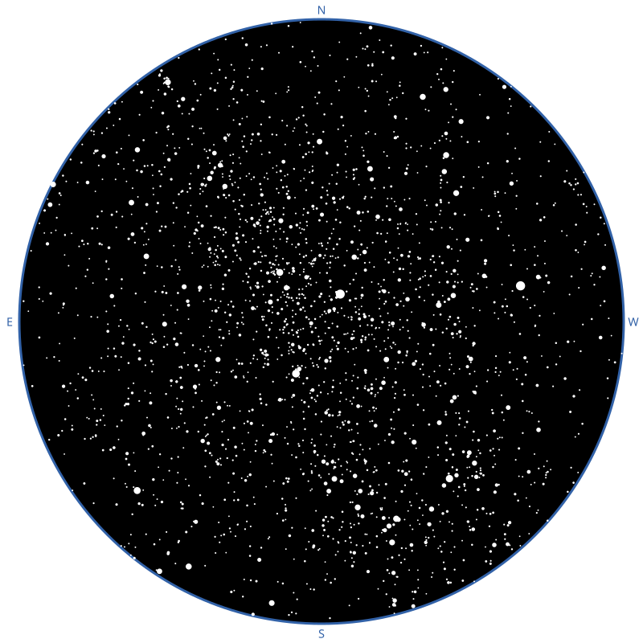
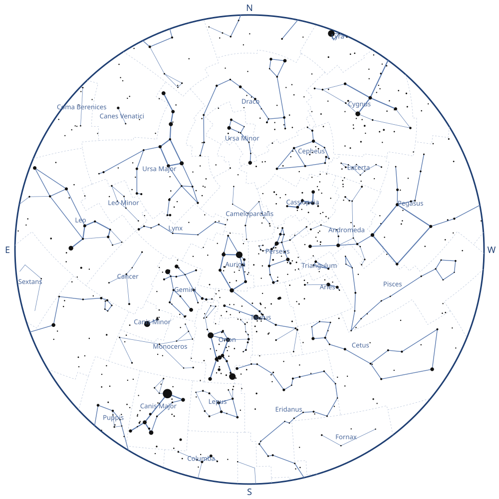
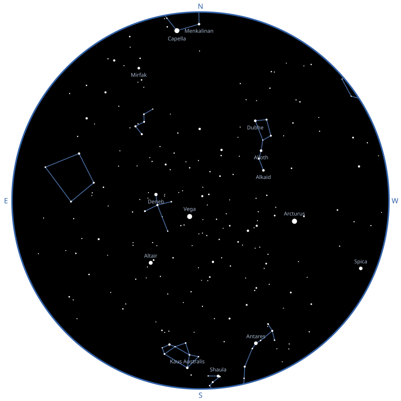
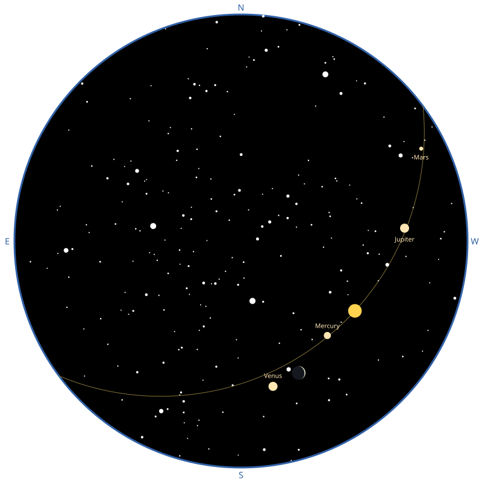
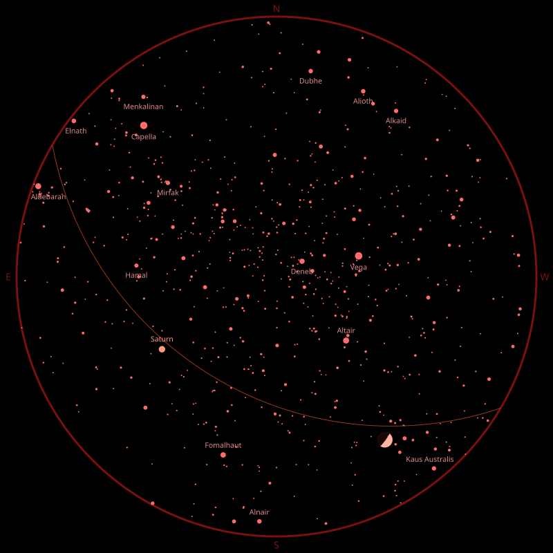
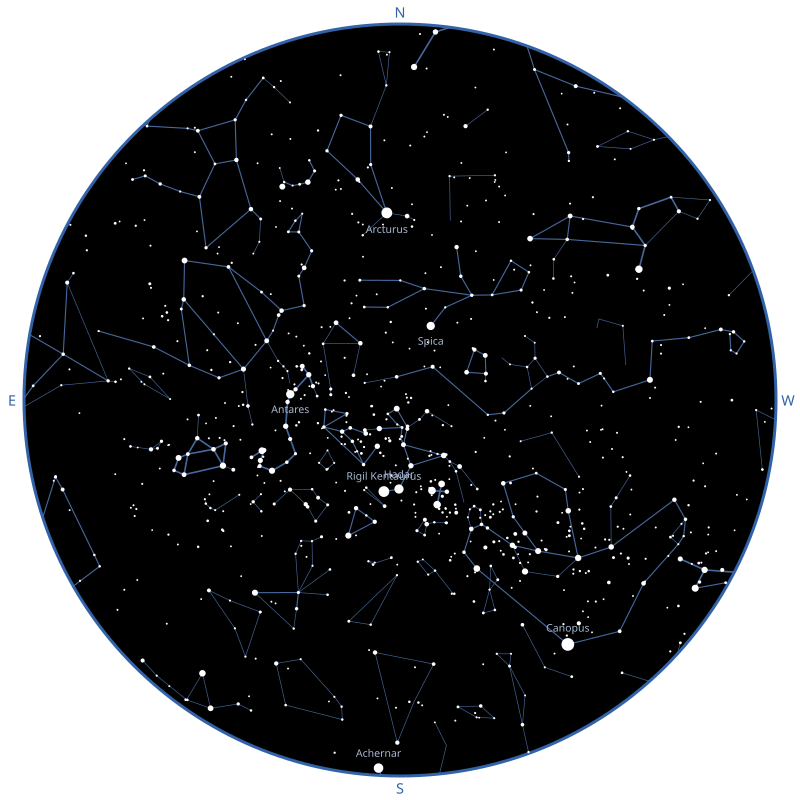
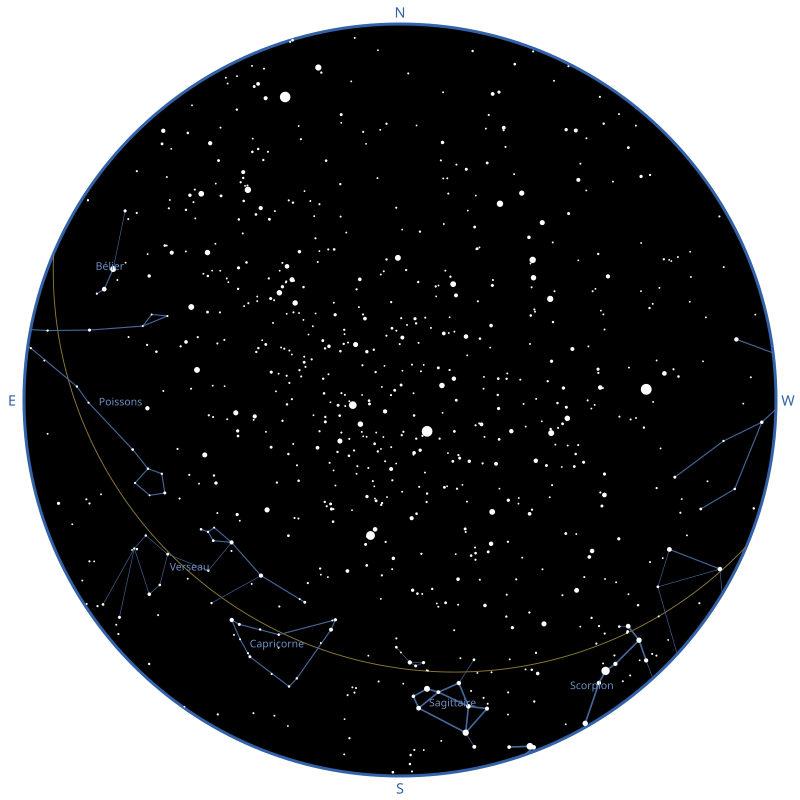
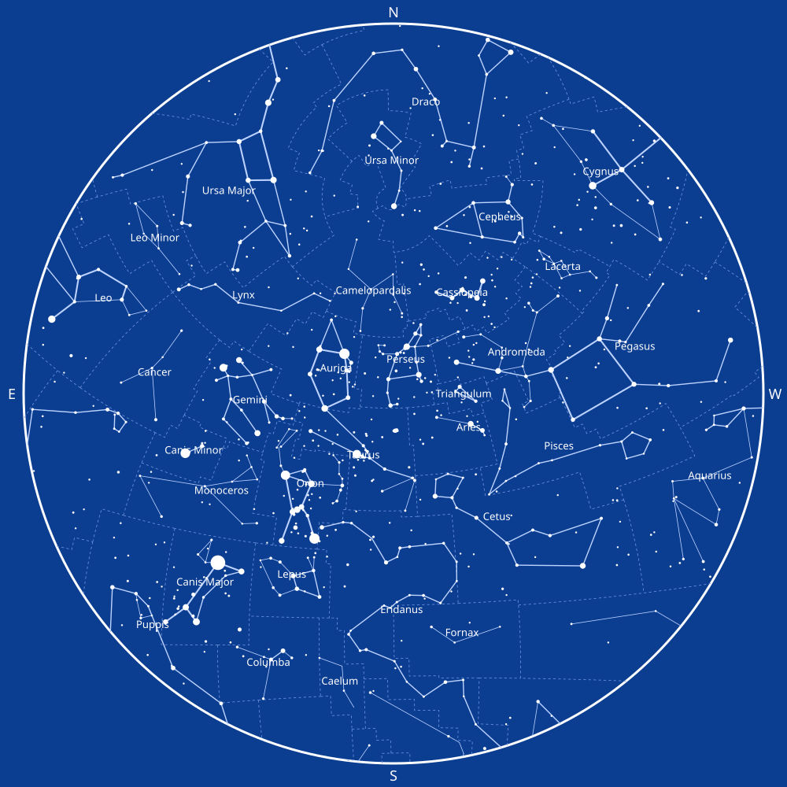

# Examples

Each example is a Ruby script that draws a map, and the SVG it draws, side by
side. They show what different combinations of layers, themes and observers
look like, so you can start from the one closest to what you want.

Run one from the root of the repository to draw its SVG again:

```bash
bundle exec ruby examples/naked_eye.rb
```

`bin/build_examples` draws all of them. CI draws them too, and fails when an
SVG differs from the one committed, so the images always match the code.

The examples with the Sun, the Moon or the planets read the ephemeris of the
tests, which only covers 2025 to 2030. To use another one, such as one you
downloaded (see the [Astronoby documentation][astronoby-ephem]), give its path
in the `EPHEMERIS` environment variable, and change the instant of the script
to a date it covers:

```bash
EPHEMERIS=inpop19a.bsp bundle exec ruby examples/solar_system.rb
```

## The naked-eye sky

Only the stars, down to magnitude 6, from a dark site in the Canary Islands.
Without the lines or the names, the map shows the sky as it looks outside.
[Code](naked_eye.rb)



## Constellations, to print

The light theme, with the boundaries, the lines and the names of all the
constellations visible from Paris on a January evening, on a larger canvas.
[Code](constellations.rb)



## Asterisms

Only the bold lines of the constellations, the best-known shapes, with the
names of the brightest stars. The Big Dipper and the Teapot of Sagittarius
stand out. [Code](asterisms.rb)



## The Sun, the Moon and the planets

No constellations, only the stars and the planets down to magnitude 4, the
ecliptic and everything else that moves along it. The planets use the same
magnitude limit as the stars, so a planet is drawn like a star of the same
brightness. [Code](solar_system.rb)



## Night vision

The night theme draws everything in red, which keeps your eyes adapted to the
dark when you use the map outside. [Code](night_vision.rb)



## The southern sky

An observer in Sydney sees the southern constellations high in the sky, such
as Scorpius and the Southern Cross, while northern stars like Arcturus stay low
in the north. Only the stars of magnitude 1 or brighter are named, to keep the
crowded center readable. [Code](southern_sky.rb)



## The zodiac

Layers draw the lines they are given, and the names they are given: here, only
the twelve constellations of the zodiac, named in French with the `names:`
option, along the ecliptic. [Code](zodiac.rb)



## A blueprint

A theme of your own, built from the dark one: white lines on blue, with a
background that fills the whole SVG. [Code](blueprint.rb)



[astronoby-ephem]: https://github.com/rhannequin/astronoby/blob/main/docs/ephem.md
